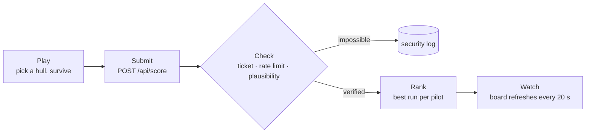

  

### hey, we're Starforge

We build **$FORGE**: a one-screen arcade shooter that runs in the browser, with a leaderboard that is honest about who is on it. Game, API, servers and deploy, end to end. We care how it **feels**, not just whether it works.

- **Arcade in the browser.** Three.js hangar, three hulls, a boss every forty seconds. Works on a phone, nothing to install, no wallet needed to play.
- **A board you can trust.** Every run is checked on the server: one-time run tickets, rate limits, plausibility checks, and a security log for everything rejected.
- **Sign-in without sign-up.** Your first finished run creates your pilot. HttpOnly session, hashed one-time recovery codes.
- **Self-hosted, boring in the good way.** Node 22 + SQLite with zero npm dependencies on the server, Docker + Caddy, automatic HTTPS, daily backups.

---

### Building: Starforge Arena

**$FORGE** is a Solana token that has not launched yet, with a real game behind it. Pick a hull, hold the forge against the swarm, break a boss every forty seconds and push your best run onto the shared board.

  
  
  

#### How a run reaches the board

A run only counts if it started on the server at least as long ago as it lasted, and each ticket counts once. Rejected runs never touch the board.

<table>
  <tr>
    <td width="33%"></td>
    <td width="33%"></td>
    <td width="33%"></td>
  </tr>
  <tr>
    <td><code>arena</code> Swarm, shards, bosses.</td>
    <td><code>leaderboard</code> Best verified run per pilot.</td>
    <td><code>hangar</code> Spark, Anvil or Flux.</td>
  </tr>
</table>

**What's inside:** one-screen arena with timed bosses · pilot campaign and hangar · live leaderboard with daily movement · run tickets and plausibility checks · sign-in without registration · hardened Docker + Caddy stack · 59 end-to-end security checks in CI.

---

$FORGE has not launched. It is a memecoin with no intrinsic value or expectation of financial return. Nothing here is financial advice.
